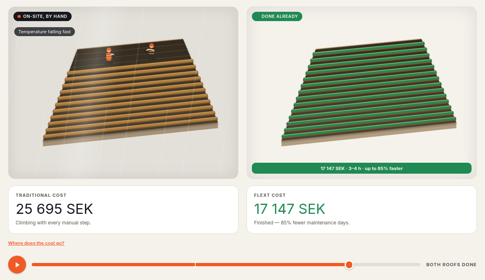
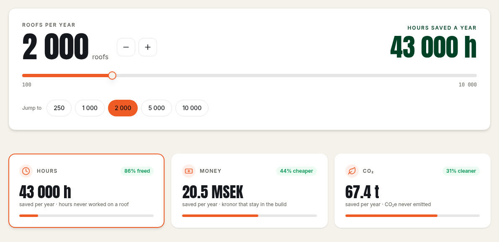
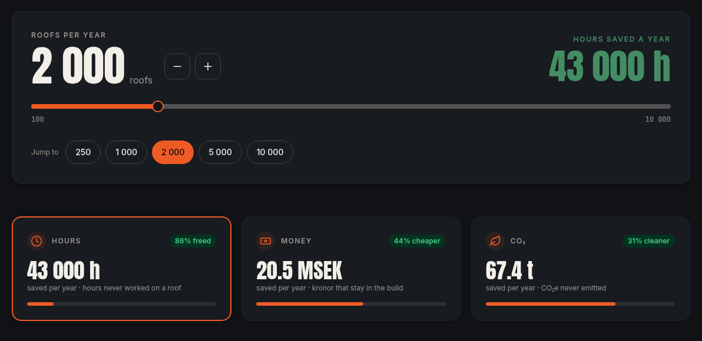
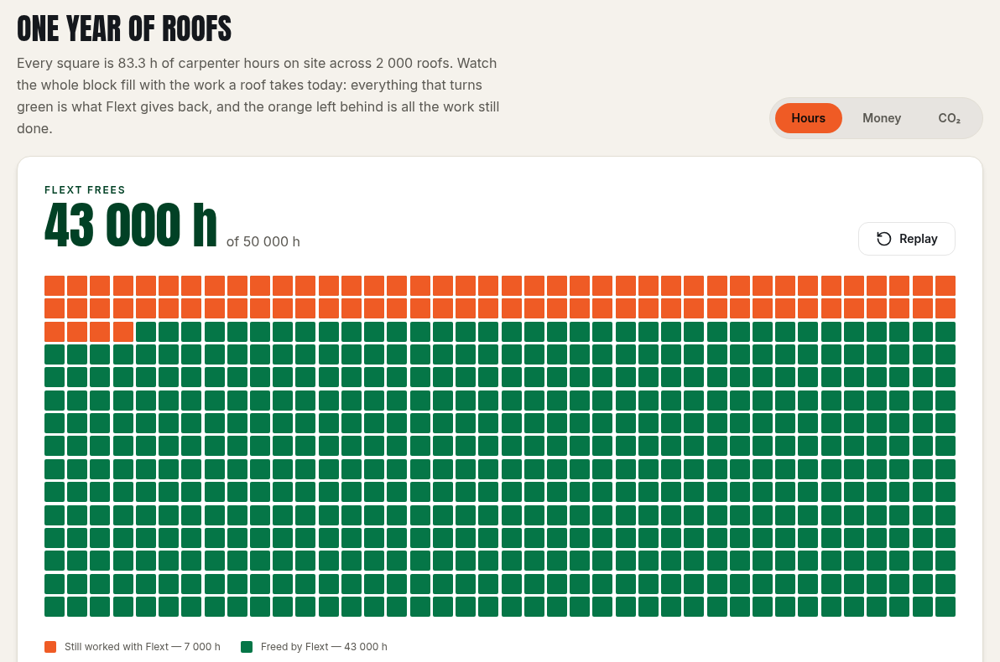
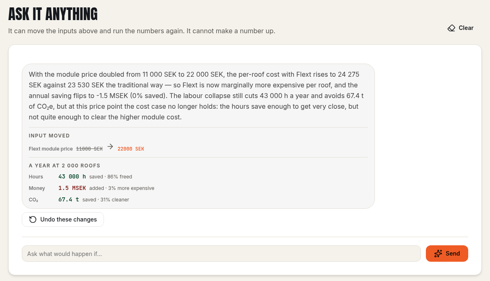
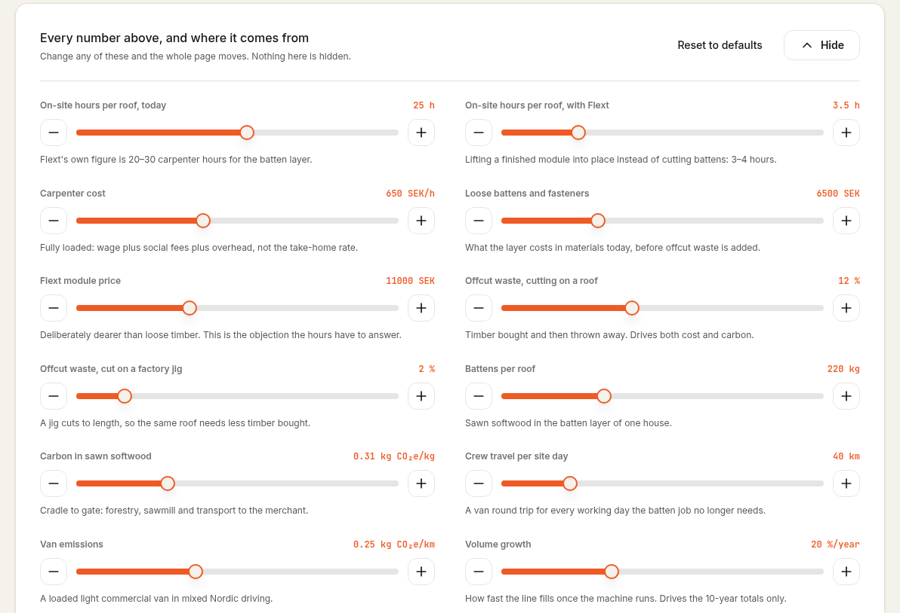

# Flext Roof Savings Calculator

**🥉 3rd place, Flext challenge, AI hackathon on the Ikon AI platform (October 2026)**

**[▶ Try it live: myhackapp-59c2b93c.ikonai.app](https://myhackapp-59c2b93c.ikonai.app/)**



Nordic houses are mostly built in factories now. The roof battens are the exception: carpenters still cut and nail them by hand on the roof, in whatever weather that day brings. Flext is a patent-pending, factory-made batten module that moves that layer indoors.

This app makes Flext's case to a builder or an investor. You set how many roofs you build a year and it shows the carpenter hours, kronor and CO₂ the switch saves. Every input behind those figures can be edited, and an AI assistant can answer "what if" questions by moving the same inputs a person would.

---

## What's in it

### 1. The roof hero
An animated scene at the top of the page builds the same 144 m² roof twice. On the left, two carpenters lay battens from the eave up while the weather turns from a dry morning to rain, wind and finally snow. On the right, a Flext module goes on at the ridge and is pulled down to the eave, finishing before the handle is halfway across. Press play or drag the handle yourself. The cost breakdown underneath (31 480 SEK by hand, 17 147 SEK with Flext) comes straight from Develog's 2024 FLEXT memorandum.

### 2. Volume and the three metrics

<table>
  <tr>
    <td></td>
    <td></td>
  </tr>
</table>

**Volume.** Set roofs per year from 100 to 10 000 with a slider, the +/- steppers or the preset chips (250, 1 000, 2 000, 5 000, 10 000). The yearly saving is shown right beside the input.

**Metrics.** The cards show **hours**, **money** and **CO₂** per year, each with a badge for the percentage gain. Click a card to see that metric in the grid.

### 3. One year of roofs, as 600 squares
The grid starts out filled orange, which is all the work a year of roofs takes today. The squares Flext saves then drain to green. What stays orange is the work still done with Flext. The caption above the grid gives the size of one square (83.3 carpenter hours at 2 000 roofs). **Replay** runs the animation again.



### 4. An assistant that moves the dials
Ask a question like *"What if carpenters cost a fifth more?"* or *"Show me the worst case for Flext"*. The assistant doesn't do the arithmetic. It calls a `move_dial` tool to change the input, the app recomputes everything in `Model.cs`, and the grid replays to show the new answer. Each reply lists exactly what it changed (`Flext module price: 11 000 SEK → 22 000 SEK`) along with the recomputed year, and an **Undo these changes** button puts the page back.



Some guardrails keep it honest:
- The assistant moves the same twelve dials a person can, and it can't push any of them outside the range its slider allows. If a request goes past a limit, the reply says so.
- It can move each dial only once per reply, so "a fifth more" can't be applied over and over.
- The current figures are rebuilt into its system prompt on every turn, so it never answers from numbers the reader has since changed.

### 5. Every assumption on the table
Under **Show the assumptions** are all twelve inputs: on-site hours before and after, carpenter rate, material and module price, waste on site and in the factory, batten mass, timber carbon, crew travel, van emissions and volume growth. Each has a slider, +/- buttons and a note on where its default comes from. **Reset to defaults** restores them all.



### 6. It shows losses too
The module price slider alone can make Flext the more expensive option. When an input does that, the page says it in plain words: badges change from *"cheaper"* to *"more expensive"*, green becomes red, and *"Saved by Flext"* becomes *"Added by Flext"*. The app never shows a green badge on top of a loss. The assistant screenshot above shows this: doubling the module price makes the money figure red, *"1.5 MSEK added · 3% more expensive"*, while hours and CO₂ stay green.

---

## The model

All the arithmetic lives in [`Model.cs`](app/MyHackApp/Model.cs). With the defaults and 2 000 roofs a year:

| | Traditional | With Flext | Saved per roof | Saved per year |
|---|---|---|---|---|
| **Carpenter hours** | 25 h | 3.5 h | 21.5 h | **43 000 h** |
| **Batten layer cost** | 23 530 SEK | 13 275 SEK | 10 255 SEK | **20.5 MSEK** |
| **CO₂e** | 107.6 kg | 73.9 kg | 33.7 kg | **67.4 t** |

- **Money** = on-site hours × loaded carpenter rate + material. Loose battens carry 12% offcut waste. The Flext module costs more on purpose (11 000 SEK against 6 500 SEK for loose material), because that's the objection Flext has to answer.
- **CO₂** = timber footprint including waste (12% on site, 2% on a factory jig), plus van trips for the crew days that no longer happen.
- **Growth** compounds yearly volume for the cumulative figures.

The defaults use Flext's own numbers where it has them (20–30 carpenter hours per roof down to 3–4) and Swedish construction norms everywhere else.

---

## Tech stack

| Layer | What |
|---|---|
| Platform | [Ikon AI](https://ikon.ai): a C# app runs in the cloud and streams reactive UI to the browser over WebSocket |
| Backend & UI | C# / .NET 10, Ikon **Parallax** server-driven components, **Crosswind** (Tailwind-style) styling |
| State | `UserReactive<T>`: each signed-in user keeps their own scenario, so two people moving sliders don't overwrite each other |
| AI | Claude Sonnet 4.6 through Ikon **Emergence**, streaming, with two tools (`read_figures`, `move_dial`) |
| Custom frontend | One React 19 component (the roof hero, hand-drawn isometric SVG and CSS), registered as a custom Parallax node so it animates on the client without a server round trip per frame |
| Theming | Warm paper and slate with one safety-orange accent, Anton for the big figures, a light/dark toggle |

---

## Project layout

```
app/MyHackApp/
├── MyHackApp.cs      # Entry point, theme, page layout, hero, volume control, stat cards
├── Model.cs          # Assumptions, the savings arithmetic, and how every figure is written
├── Dials.cs          # The twelve editable inputs (ranges, steps, units, rationale), shared by the UI and the assistant
├── Panels.cs         # The 600-square grid animation and the assumptions panel
├── Chat.cs           # The assistant: streaming, tools, per-turn undo
└── RoofHero.cs       # Memorandum figures + the C# bridge to the React roof hero

frontend-node/src/lib/roof-hero/   # The React/SVG roof animation
.ikon/gates/                       # Automated UI checks (see below)
public/flext-logo.svg              # Flext wordmark
```

---

## Running it

The quickest way to see it is the [live deployment](https://myhackapp-59c2b93c.ikonai.app/). To run it yourself you need the [Ikon CLI](https://ikon.ai) and the .NET 10 SDK.

```bash
ikon run
```

The local URLs are written to `build/app/artifacts/bin/MyHackApp/debug/ikon-server-info.json`.

### Checks

Two check gates in [`.ikon/gates/`](.ikon/gates) drive the real UI and test what it shows:

- **`savings-arithmetic`**: 2 000 roofs gives 43 000 h, 20.5 MSEK and 67.4 t.
- **`chat-and-adverse-case`**: the assistant panel and its suggested questions render, every preset chip sets the number printed on it, and a 30 000 SEK module price makes the page say "more expensive" and nowhere "cheaper".

```bash
ikon test
```

---

## Sources

- Develog, *FLEXT: Removable Prefabricated Decking* (memorandum, 2024). Supplies the 144 m² reference roof cost breakdown, the 20–30 → 3–4 hour figure, up to 85% less installation time, 85% fewer maintenance days and 10–20 years of extra roof life.
- Swedish construction norms for carpenter rates, timber carbon and van emissions. All of them can be changed in the app.

---

Built by **[Abdou](https://github.com/Chouia-Abderrahman)** during the hackathon, on the [Ikon AI](https://ikon.ai) platform.
